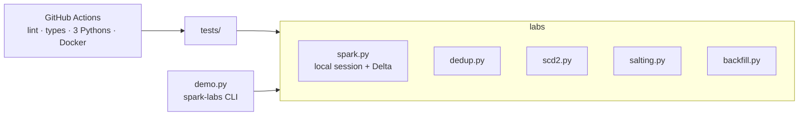
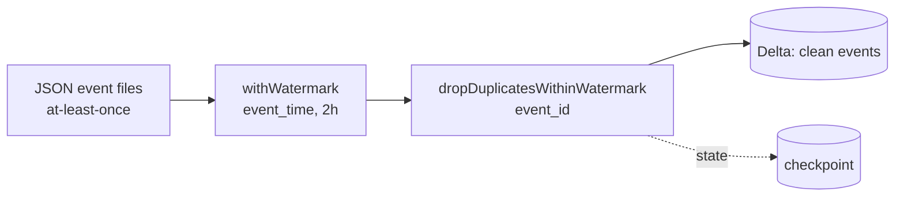
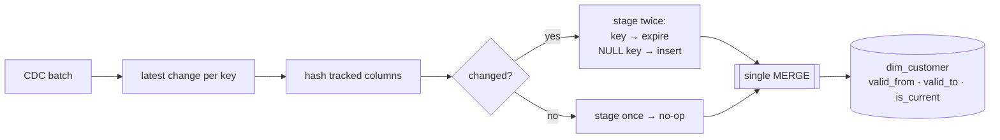
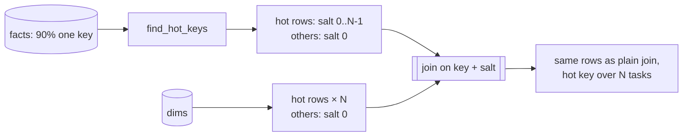
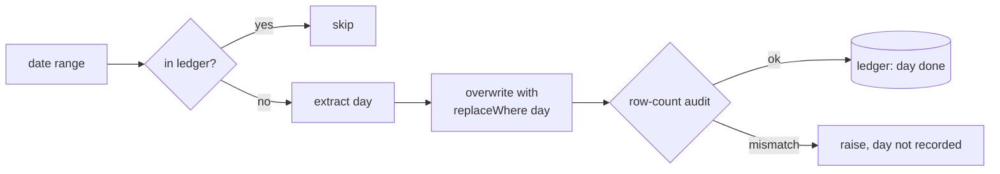

# Architecture

Each lab is a small, pure module in `labs/` that takes DataFrames or paths in and
writes Delta tables out. Nothing depends on a cluster, a metastore or cloud storage,
so the same code runs in tests, in the demo and inside a real job.

## Design rules

1. **Every lab proves one property, and a test asserts it.** "No duplicates after a
   replay", "rerun is a no-op", "same rows as the plain join", "identical after a full
   rerun". If the property breaks, CI goes red.
2. **Idempotent by construction.** Re-running any lab with the same input leaves the
   output unchanged. That is the property production pipelines lose first.
3. **Paths, not catalogs.** Delta tables are addressed by path so the labs run on a
   laptop. Swapping to `saveAsTable` / Unity Catalog is a one-line change.
4. **Small, typed, linted.** `ruff` and `mypy` run before tests in CI.

## Lab 01 · Streaming dedup

State holds only ids inside the watermark. The checkpoint records processed files and
dedup state, so replaying an input file is safe.

## Lab 02 · SCD Type 2

## Lab 03 · Skew salting

## Lab 04 · Idempotent backfill

